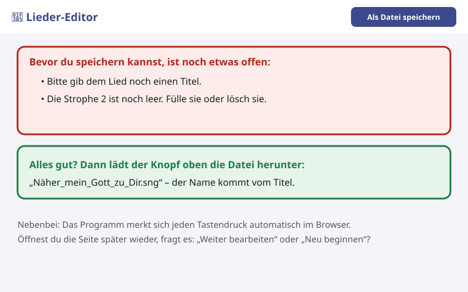

# Lieder-Editor

Ein Editor für Lieder im SongBeamer-Format (`.sng`). Du brauchst keine Technikkenntnisse:
Du arbeitest mit **Strophe, Refrain, Bridge und Co.** – den Rest (das Dateiformat) macht das
Programm automatisch im Hintergrund.

Alles läuft **direkt in deinem Browser** (am Laptop oder am Tablet). Es gibt keinen Server, kein
Konto und keine Datenbank. Nichts wird ins Internet hochgeladen.

---

## So benutzt du den Editor

### Schritt 1: Startseite


- **„Neues Lied“** – du fängst mit einem leeren Lied an.
- **„Datei öffnen“** – du lädst eine vorhandene `.sng`-Datei (auch durch Draufziehen auf die
  Seite). Die Datei wird automatisch gelesen: Titel, Autor und alle Liedteile erscheinen als
  Karten.

### Schritt 2: Kopfdaten ausfüllen


Oben steht der **Titel** – das ist das einzige Pflichtfeld. Daneben kannst du mit einem Klick
zwischen **„Einsprachig“** und **„Zweisprachig“** umschalten (für zweisprachige Lieder erscheint
dann auch ein Feld für den Titel in der 2. Sprache).

Darunter stehen die wichtigsten freiwilligen Angaben: Autor, Melodie, CCLI/Liednummer, Copyright
und Notizen. Über **„Weitere Angaben“** klappst du bei Bedarf alle weiteren SongBeamer-Felder auf:
**Tonart, Taktart, Tempo (BPM), Liederbuch, Gemeinde-Nr., Originaltitel, Übersetzung, Rechte/Lizenz,
Kategorien, Suchbegriffe und Bibelstelle**.

### Schritt 3: Abspielreihenfolge & Liedteile


- **Abspielreihenfolge (optional, per Drag’n’Drop):** Über den Karten kannst du festlegen, in
  welcher Reihenfolge die Teile im Gottesdienst gespielt werden (z. B. *Intro → Chor → Vers 1 →
  Pre-Refrain → Refrain → Chor → Vers 2 …*). So kannst du den Refrain mehrfach abspielen, ohne den
  Text doppelt zu schreiben – einfach Bausteine anklicken und mit der Maus oder dem Finger ziehen.
- **Liedteile als Karten:** Jeder Liedteil ist eine Karte mit Sinnbild, Farbe und Namen. Bei
  **zweisprachigen Liedern** hat jede Karte automatisch zwei getrennte Textfelder nebeneinander
  (**Sprache 1** und **Sprache 2**), ohne dass du jemals Steuerzeichen eintippen musst.

Unter der Liste liegen drei große Knöpfe:

- **„+ Strophe hinzufügen“** – wird automatisch nummeriert (Vers 1, Vers 2, …)
- **„+ Refrain hinzufügen“** – (Refrain, Refrain 2, …)
- **„Weiteres Teil ▾“** – öffnet ein Menü mit Bridge, Pre-Refrain, Pre-Bridge, Intro, Schluss,
  Zwischenspiel, Instrumental, Chor, gesprochenem Text, Antwort, Solo und weiteren Teilen

In jede Karte schreibst du den Text direkt hinein. **Mehrere Zeilen** sind möglich; eine
**leere Zeile** macht später Abstand auf der Folie.

An jeder Karte kannst du:

- **umbenennen** (auf den Namen klicken – die Abspielreihenfolge aktualisiert sich automatisch mit),
- **verschieben** – am Laptop mit der Maus am Griff-Symbol (⠿) ziehen, am Tablet **lange auf das
  Griff-Symbol drücken** und dann ziehen; alternativ die Knöpfe „Nach oben“ / „Nach unten“,
- **wiederholen** („Teil wiederholen“ legt eine zweite, unabhängige Karte mit demselben Namen
  an – beim Speichern wird sie als eigener Abschnitt ausgeschrieben),
- **löschen** – erst ein Klick, dann erscheint „Wirklich löschen?“ zum zweiten Klick,
- **Text übernehmen** – kopiert den Text der Karte in die Zwischenablage.

### Schritt 4: Vorschau


Rechts (auf dem Tablet darunter) siehst du die **Folie im Hochformat**, so wie die Gemeinde sie
später sieht: große Schrift, alles mittig. Bei zweisprachigen Liedern kannst du oben in der
Vorschau zwischen **Beide / 1 / 2** umschalten. Lange Folien werden automatisch passend verkleinert;
ab 9 Zeilen erscheint ein kurzer Lesbarkeitstipp.

### Schritt 5: Speichern



Der Knopf **„Als Datei speichern“** prüft das Lied zuerst und meldet in schlichter Sprache, was
noch fehlt, zum Beispiel:

- „Bitte gib dem Lied noch einen Titel.“
- „Die Strophe 2 ist noch leer. Fülle sie oder lösch sie.“
- „Im Refrain stehen nur leere Zeilen.“
- „Das Lied hat noch keine Teile. Füge eine Strophe hinzu.“

Mit einem Klick auf eine Meldung springst du direkt an die passende Stelle.

Ist alles gut, lädt der Browser die fertige `.sng`-Datei herunter. Der Dateiname entsteht aus
dem Titel, zum Beispiel `Näher_mein_Gott_zu_Dir.sng`.

**Nebenbei:** Das Programm merkt sich jeden Tastendruck automatisch in deinem Browser (oben
erkennbar an *„✓ Im Browser gesichert“*). Öffnest du die Seite später wieder, fragt es:
*„Ungespeicherte Änderungen wiederherstellen?“* mit dem Titel deines Entwurfs und den Knöpfen
**„Weiter bearbeiten“** und **„Neu beginnen“**.

**Rückgängig:** Jeder Schritt lässt sich rückgängig machen – mit **Strg + Z** (am Mac
**Cmd + Z**) oder dem Knopf **„Rückgängig“** oben. Nichts geht durch einen Fehlklick verloren.

### Ohne Maus und auf dem Tablet

Der ganze Ablauf geht auch **nur mit der Tastatur** (Tabulator springt durch alle Felder und
Knöpfe, Enter aktiviert sie). Auf kleinen Bildschirmen (Tablet) klappt alles untereinander –
du musst nichts waagerecht verschieben.

---

## Auf GitHub Pages veröffentlichen

Die Datei `.github/workflows/pages.yml` baut bei jedem Einliefern (Push auf den Zweig `main`)
die Anwendung, führt die Unit-Tests aus und veröffentlicht das Ergebnis automatisch auf
**GitHub Pages**.

**Einrichtung im GitHub-Repository (einmalig):**

1. Im Repository oben auf **„Settings“** klicken.
2. Links im Menü auf **„Pages“** klicken.
3. Bei **„Source“** (Quelle) auswählen: **„GitHub Actions“**.
4. Speichern.

**Wohin führt die Adresse?** Auf
`https://<dein-github-name>.github.io/Lieder-Editor/` – also hier:
`https://gschmalzhaf-cell.github.io/Lieder-Editor/`. Der Basispfad (`/Lieder-Editor/`) wird
beim Bauen automatisch aus dem Repository-Namen abgeleitet (`vite.config.ts`).

Nach dem ersten Push auf `main` (oder über **Actions → „Bauen, prüfen und auf GitHub Pages
veröffentlichen“ → „Run workflow“**) ist die Seite nach wenigen Minuten online.

---

## Eigene Lieder als Prüfdateien legen

Im Verzeichnis `tests/fixtures/` liegen Beispieldateien (erfundene und echte Lieder). So legst
du eigene echte Lieddateien als Prüfdateien an:

1. Kopiere die `.sng`-Datei in den Ordner `tests/fixtures/` (z. B. als `mein-lied.sng`).
2. Füge sie dem Git-Repository hinzu (`git add tests/fixtures/mein-lied.sng`) und liefere ein.
3. Beim nächsten Ablauf liest der Test die Datei automatisch mit, schreibt sie wieder aus und
   prüft, ob sie **zeichenweise identisch** bleibt.

Die kodierten Varianten (Windows-1252, UTF-16, BOM, CRLF) kannst du mit
`node tools/make-fixtures.mjs` neu erzeugen.

---

## In SongBeamer selbst nachprüfen

So testest du, ob SongBeamer eine Datei aus dem Editor laden kann:

1. Erstelle im Editor ein Lied mit mindestens **Strophe, Refrain und Bridge** und klicke
   **„Als Datei speichern“**.
2. Öffne SongBeamer auf einem Windows-Rechner.
3. Menü **„Datei → Öffnen“** (oder **„Lieder“ → Lied importieren**) und wähle die heruntergeladene
   `.sng`-Datei aus.
4. Das Lied erscheint in der Liederliste; beim Öffnen siehst du die Abschnitte (Vers 1,
   Refrain, Bridge) und kannst die Folien durchblättern.

Tipp: Lege die Datei alternativ in den Liederordner von SongBeamer und starte SongBeamer neu.

---

## Tests lokal ausführen

Voraussetzung: Node.js (Version 22 oder neuer) ist installiert.

```bash
npm install     # einmalig: Abhängigkeiten laden
npm run test    # Unit-Tests (Lesen/Schreiben der Dateien, Rundläufe, Zeichensätze)
npm run dev     # Entwicklungsserver starten (localhost:5173)
npm run build   # Produktionsbau nach dist/
```

Die Tests prüfen unter anderem: Rundlauf unverändert (jede Prüfdatei wird gelesen und
byte-identisch wieder ausgegeben), Rundlauf nach einer Änderung, Windows-1252 mit ä/ö/ü/ß,
UTF-16, eigene Abschnittsmarker (`$$M=`), unbekannte Kopfzeilen, mehrsprachige Dateien,
Folien-Vorschau und die Klartext-Meldungen vor dem Speichern.

---

## Annahmen zum Dateiformat (Begleittext)

Wo die Formatbeschreibung Spielraum ließ, wurde der einfachste Fall gewählt:

- **Teilname erkennen:** Steht direkt nach `---` ein reservierter SongBeamer-Name
  (Vers/Verse/Strophe, Refrain/Chorus, Bridge, Pre-Bridge, Intro, Outro/Schluss/Ending,
  Zwischenspiel/Interlude/Instrumental, Pre-Chorus, Pre-Refrain, Pre-Coda, Teil/Part, Tag, Coda,
  Unbekannt/Unknown/Unbenannt/Misc – jeweils mit optionaler Nummer oder Buchstabe, z. B.
  „Vers 1“, „Vers 1a“, „Teil A“ – oder mit `$$M=…` für eigene Namen), wird diese Zeile als
  Teilname gelesen. Sonst beginnt dort direkt der Text (Teil ohne Namen).
- **Eigene Teilnamen sicher speichern:** Frei gewählte Namen (z. B. „Gesprochener Text“, „Solo“
  oder ein umbenanntes Teil wie „Kinderchor“) erhalten beim Schreiben automatisch das
  SongBeamer-Präfix `$$M=`, damit SongBeamer sie sicher als Foliennamen erkennt und nicht als
  Liedtext projiziert. In der Oberfläche ist `$$M=` niemals sichtbar.
- **Namen bleiben erhalten:** Beim Lesen übernommene Namen (z. B. „Strophe 1“, „Chorus“) werden
  1:1 wieder ausgegeben. Neu angelegte Strophen heißen automatisch „Vers 1“, „Vers 2“, …; beim
  „Teil wiederholen“ wird der Name mitgeführt (zweiter Abschnitt mit gleichem Namen).
- **Kopfdaten-Schlüssel:** Titel → `#Title`, Autor → `#Author`, Melodie → `#Melody`,
  Liednummer → `#CCLI` (bei reinen Zahlen) bzw. `#Songbook` (bei Angaben mit Buchstaben wie
  „EG 331“; beim Lesen werden `#CCLI`, `#SongNumber`, `#Songbook` und `#ChurchSongID` erkannt),
  Copyright → `#(c)` (beim Lesen wird auch `#Copyright` erkannt), Notizen → `#Comment`. Beim
  Schreiben neuer/geänderter Dateien beginnt der Kopf mit `#Title`, dann die weiteren bekannten
  Angaben, dann alle unbekannten Angaben in ursprünglicher Reihenfolge; `#LangCount=1` und
  `#Version=3` werden ergänzt, falls nicht vorhanden.
- **Zeichensatz:** Lesen erkennt UTF-8 (mit/ohne BOM), UTF-16 (LE/BE, mit BOM) und fällt
  sonst auf Windows-1252 zurück. Schreiben ist immer UTF-8 – neu erzeugte Dateien und Dateien,
  die nicht als UTF-8 gelesen wurden, bekommen ein BOM, damit SongBeamer sie sicher als UTF-8
  erkennt. UTF-8-Dateien ohne BOM bleiben beim Rundlauf ohne BOM (zeichengetreu).
- **Zeilenenden:** Windows (CRLF) und Unix (LF) werden erkannt und mitgeführt; neu erzeugte
  Dateien bekommen CRLF (Windows-Standard von SongBeamer). Am Dateiende steht bei neuen
  Dateien eine Leerzeile.
- **Weiche Folienumbrüche & Auszeichnungen:** `--`, `--A`, Zeilen-Präfixe (`#H `, `#0 `, `#1 ` …)
  und HTML-artige Auszeichnungen (`<b>…</b>`, `<i>…</i>`, `<u>…</u>`, `<br>`, `<color:…>`)
  bleiben im Textfeld unverändert erhalten und werden 1:1 ausgegeben. In der **Vorschau**
  werden sie so dargestellt, wie SongBeamer sie projiziert (`#H `-Kommentare ausgeblendet,
  Fett/Kursiv/Unterstrichen gerendert, `--` als Trennlinie).
- **Mehrsprachige Dateien** (`#LangCount` > 1) werden vollständig übernommen und unverändert
  wieder ausgegeben; der Editor weist mit einem Hinweis darauf hin und färbt in der Vorschau
  die zweite Sprache dezent ab.
- **„Übernehmen“** bedeutet: Der Text einer Karte wird in die Zwischenablage kopiert, um ihn in
  eine andere Karte einzufügen.

---

## Technik (kurz)

- Statische Web-App mit **React + TypeScript**, gebaut mit **Vite**.
- Ziehen und Verschieben: **@dnd-kit** (kleine, gepflegte Bibliothek).
- Unit-Tests mit **Vitest**.
- Veröffentlichung über **GitHub Actions** auf GitHub Pages (siehe oben).

Projektstruktur:

```
index.html            Einstieg
src/sng/              Lesen und Schreiben der .sng-Dateien (reine Logik, ohne UI)
  decode.ts           Zeichensatz-Erkennung (UTF-8, UTF-16, Windows-1252)
  parse.ts            Leser: Datei -> Datenmodell
  serialize.ts        Schreiber: Datenmodell -> Datei
  names.ts            Teilnamen (deutsch/englisch) erkennen und erzeugen
  validate.ts         Klartext-Prüfung vor dem Speichern
  filename.ts         Dateiname aus dem Titel
src/ui/               Oberfläche (Startseite, Editor, Karten, Vorschau)
src/state/            Rückgängig-Verlauf und automatisches Speichern im Browser
tests/                Unit-Tests
tests/fixtures/       Prüfdateien (Beispiele und echte Lieder)
tools/make-fixtures.mjs  Erzeugt die kodierten Prüfdateien
.github/workflows/    GitHub-Actions-Ablauf (Bauen, Tests, Pages)
docs/                 Bilder für diese Anleitung
```
